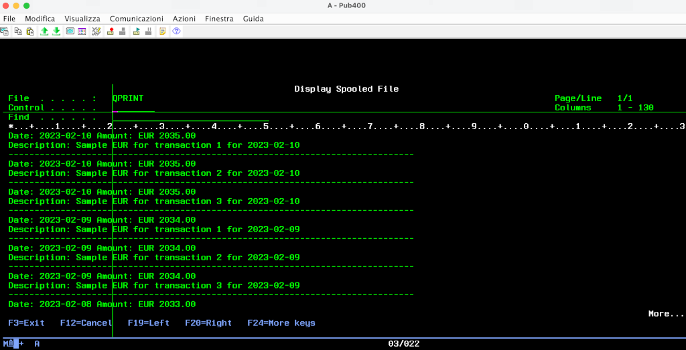

# Using REST APIs on IBM i: an example for Open Banking
There are many ways to use external REST APIs from IBM i.
In the following example we will see how to read Open Banking data.
To do that we will use:
* SQL functions [HttpPostClob](https://www.ibm.com/docs/en/i/7.3?topic=overview-httppostblob-httppostclob-scalar-functions) 
abd [HttpGetCLob](https://www.ibm.com/docs/en/i/7.3?topic=overview-httpgetblob-httpgetclob-scalar-functions), that let perfomr HTTP POST e GET calla using simple SQL sgtatements. (See Roberto De Pedrini's Italian blog [qui](https://blog.faq400.com/it/database-db2-for-i/qsys2-http-functions-it/)).
* SQL function [Json_Table](https://www.ibm.com/docs/en/i/7.3?topic=data-using-json-table) that converts a JSON dcument into a table in the DB2 for i database.
* RPG ILE in free format.
    
## Getting a JWT tokens via POST
REST APIs are stateless REST, i.e. the status of the communication between client and server is not saved in the server between different calls.
Each time we make a request to the server, it seems a brand new one to it. Therefore it should contain all the needed information for client authentication. 
One of the techniques often used for this purpose is to send the user/password pair in an initial authentication call, 
which returns a token signed by the server (a JSON Web Token o [JWT](https://jwt.io/introduction)), This token, which has an expiring time, the server certifies the user identity. 
The token is then transmitted in all subsequent calls (until it expires) without the need to resubmit credentials.
[A-CUBE service for Open Banking](https://docs.acubeapi.com/documentation/open-banking), 
works this way [see documentation](https://docs.acubeapi.com/documentation/common/authentication/).
Let's see [the sample program that starts the communication](getjwt.rpgle). 

The authentication service will return a JSON response like this one: 
```json
{ "token": "a very long encrypted token" }
```
Let's define DS that we will use to extract the `token` field:
```rpgle
dcl-ds jsonData   qualified;
  token      varchar(2048);
end-ds;
```

We then compose the variables that will be useful for making the call, taking user and password from environment variables:
```rpgle
WebServiceUrl = 'https://common-sandbox.api.acubeapi.com/' +
                  'login';

WebServiceHeader = '<httpHeader>-
                       <header name="content-type" value="application/json" />-
                     </httpHeader>';

Email = %str(getenv('ACUBE_EMAIL'));
Password = %str(getenv('ACUBE_PASSWORD'));

WebServiceBody   = '{"email": "' + Email + '", "password": "' + Password + '"}';
```
Let's see the most important part now. Using SQL statements embedded in our RPG program, we can:
1. run an HTTPPOST toward the API server with `Systools.HttpPostClob`
```rpgle
Systools.HttpPostClob(:WebServiceUrl, :WebServiceHeader, :WebServiceBody)
``` 
2. transform the JSON response into a SQL table with `Json_Table`:
```rpgle
Select * from
   Json_Table(Systools.HttpPostClob(:WebServiceUrl, :WebServiceHeader, :WebServiceBody),
    '$'
    Columns(Token VarChar(2048)  Path '$.token'));
``` 
The `$` expressions describe the path in the JSON file for extracting data: 
`$` is the current poin, `$.myField` is field `myField` in the current object. [You can run some tests here](https://jsonpath.com/) with this `JSONPath` syntax.
3. Read the data from the above table and put it into a DS.
```rpgle
Exec Sql
     Fetch Next From Csr01 into :jsonData
``` 
4. Put the token into an environment variable for next programs.
```rpgle
putenv('ACUBE_TOKEN=' + jsonData.token);
``` 

## Who is the owner of the Bank Account? (Business Registry)
I wrote a [sample program](createbr.rpgle) that tells to the API server the infos related to the owner of the Bank Account (a Business Registry in A-Cube's jargon) that uses another interesting SQL function.

The REST API for creating a Business Registry needs POST with a bigger payload. 
To handle it easily, we can write it into the IFS in a stream file similar to [this one](br.json), 
and then we will be able to read it using SQL function [IFS_READ](https://www.ibm.com/docs/en/i/7.3?topic=is-ifs-read-ifs-read-binary-ifs-read-utf8-table-functions).
This function has a parameter which is the file path (we get it from an environment variable in our example), the maximum line size 
and the line delimiter. In the example we specify `NONE` as the delimiter because we wish to read the whole file as a single line.
The contents of the resulting file are then placed in a variable that will be the body of our POST to the API.
```rpgle
JsonInputFile = %str(getenv('ACUBE_IFS_JSON'));

Exec SQL
Declare File Cursor For
    SELECT CAST(LINE AS CHAR(2048))
    From Table(IFS_READ(:JsonInputFile, 2048, 'NONE' )) As IFS;
Exec SQL Open File;

Exec SQL Fetch Next From File Into :WebServiceBody;    
```
Another interesting part is the composition of the header that includes the JWT token placed in an environment variable from the previous program.
```rpgle
Token = %str(getenv('ACUBE_TOKEN'));

WebServiceHeader = '<httpHeader> ' +
'  <header name="authorization" value="bearer ' + Token + '" /> ' +
'  <header name="accept" value="application/json" /> ' +
'  <header name="content-type" value="application/json" /> ' +
'</httpHeader>';
```
## Connect a bank account and list its transactions
RPGLE program [connect.rpgle](connect.rpgle) produces a URL to connect to tell the bank that we consent the reading of our data. 
It works pretty much like the other ones.

Lat program then [reads transactions from our bank account](transacts.rpgle). 
As an example I print those data, but you can obviously use these infos as you prefer .



## Conclusion

We saw how simple it is to use REST APIs from IBM i (allow me, the evolution of our beloved AS400), 
leveraging the power of IBM DB2 for i's SQL functions.

A big thank yo to [PUB400](https://pub400.com/), the free IBM i hosting solution I utilized for compiling these samples.